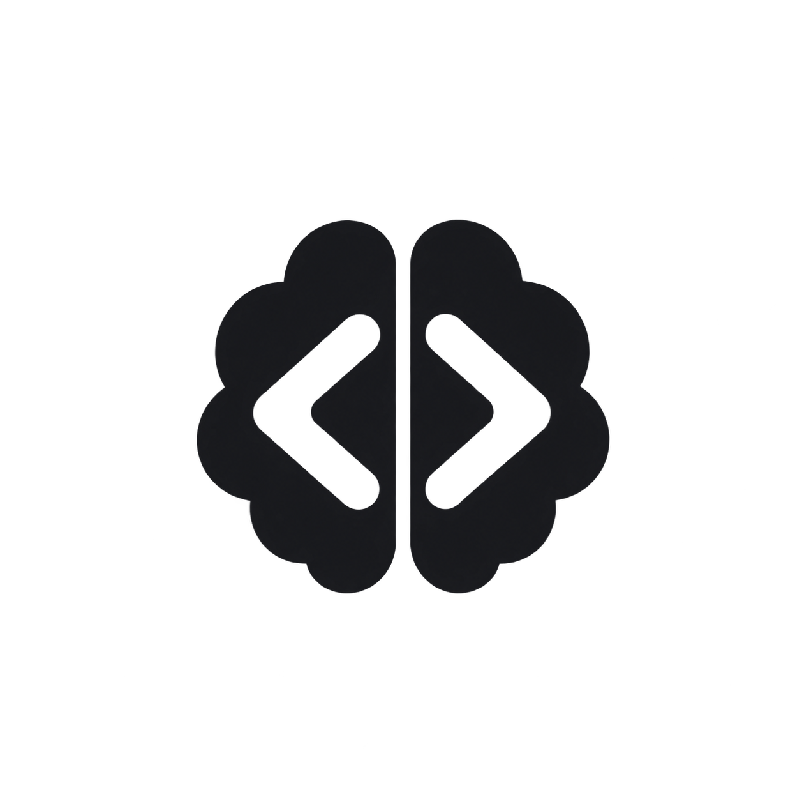
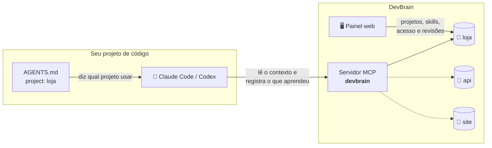

<div align="center">

<picture>
  <source media="(prefers-color-scheme: dark)" srcset="public/icon-dark.png" />
  
</picture>

# DevBrain

### A memória de longo prazo dos seus agentes de código.

Regras, skills, decisões e notas de cada projeto em um repositório git,
entregues ao **Claude Code**, ao **Codex** e a qualquer agente compatível por **um único servidor MCP**.


[Como funciona](#-como-funciona) ·
[Em 3 passos](#-em-3-passos) ·
[Recursos](#-recursos) ·
[Rodando](#-rodando) ·
[Ferramentas MCP](#-ferramentas-mcp)

</div>

---

## 🧠 Por que existe

Todo agente de código começa a sessão do zero. Ele não lembra as convenções do time, as decisões do mês passado nem o
"aqui não pode fazer push". Você explica de novo, ou ele erra de novo.

O **DevBrain** resolve isso dando a cada projeto um **repositório git de contexto**. É ali que ficam as regras, as
skills, a visão geral, as tasks e as notas. Esse contexto chega ao agente pelo MCP, e o agente é obrigado a lê-lo
antes de mexer em qualquer coisa. Ao terminar, ele grava o que aprendeu, e cada gravação vira um commit.

> **Git é a fonte da verdade.** O PostgreSQL guarda só metadados e estado operacional. O conteúdo tem histórico
> completo, diff e blame, como qualquer código.

## 🔁 Como funciona



- **Um servidor só.** Você instala o MCP `devbrain` uma vez por máquina e ele atende todos os projetos.
- **O `AGENTS.md` aponta o projeto.** Cada projeto de código diz qual é o seu slug no DevBrain, e o agente o passa em
  toda chamada.
- **Você controla o acesso.** Só projetos **ativos** respondem. Num projeto desativado, o agente recebe um aviso para
  pedir a reativação, e você recebe uma notificação.

## 🚀 Em 3 passos

**1. Crie o projeto.** Pelo painel, ou peça ao agente (`create_project`). O repositório nasce pronto, no padrão do hub:

```
loja/
├── README.md            # índice: "quando carregar" cada arquivo
├── 00-base.md           # visão geral do produto e dos repositórios
├── skills/              # regras obrigatórias (ex.: proibido-push, commit-do-context)
├── tasks/               # registro das tasks
├── notas/               # descobertas e decisões, datadas
├── templates-pr/        # modelos de descrição de PR
└── raiz/                # AGENTS.md, CLAUDE.md e .claude/ para a raiz do projeto de código
```

**2. Instale o MCP uma vez.** Em **MCP → Instalação**, gere a chave de acesso e copie o comando já preenchido:

```bash
# Claude Code
claude mcp add --transport http --scope user devbrain https://seu-app/api/mcp \
  --header "Authorization: Bearer <SUA_CHAVE>"

# Codex
export DEVBRAIN_TOKEN="<SUA_CHAVE>"
codex mcp add devbrain --url https://seu-app/api/mcp --bearer-token-env-var DEVBRAIN_TOKEN
```

**3. Cole o `AGENTS.md` no projeto de código.** Em **MCP → AGENTS.md**, escolha o projeto e copie ou baixe o texto (ele
também já vem em `raiz/AGENTS.md`). É ele que torna o MCP **obrigatório**: o agente lê o índice e as skills antes de
qualquer task, lista o que leu, registra o que aprender e para se o MCP falhar.

## ✨ Recursos

<table>
<tr>
<td width="50%" valign="top">

### 📁 Projetos
Um repositório git de contexto por projeto, com navegação de arquivos, histórico de commits e um gráfico de atividade
no dashboard. Ative ou desative o acesso do MCP com um clique.

</td>
<td width="50%" valign="top">

### 🔌 Um MCP para tudo
Servidor Streamable HTTP com uma única chave de acesso, da qual só o hash é guardado. Gerar uma chave nova revoga a
anterior, e **Revogar todos os tokens** derruba todo acesso de uma vez.

</td>
</tr>
<tr>
<td valign="top">

### ✨ Skills em três níveis
**Universais** valem para todos os projetos. As da **biblioteca** são criadas uma vez e aplicadas em vários projetos. As
**de projeto** são de um só. Tem busca com grifo, promoção a universal e importação de `SKILL.md`.

</td>
<td valign="top">

### 📝 Editor Markdown
CodeMirror 6 com barra de formatação, modo dividido e preview (GFM, sem HTML cru). Os arquivos do repositório abrem
renderizados ou como código.

</td>
</tr>
<tr>
<td valign="top">

### 🤖 Assistente de IA
Um chat no canto da tela que cria skills e projetos e grava contexto. Cada ação aparece como um passo, com o antes e o
depois. Ações destrutivas pedem sua aprovação, e essa regra é imposta no servidor.

</td>
<td valign="top">

### ✅ Revisão humana
Quando a mudança precisa de aprovação, o agente usa `propose_change` em vez de gravar direto. A proposta fica pendente
no projeto, e você é notificado.

</td>
</tr>
<tr>
<td valign="top">

### 🔔 Notificações
Avisos de propostas novas e de agentes tentando usar projetos desativados.

</td>
<td valign="top">

### 🪵 Logs
Erros e eventos do servidor (inclusive cada ferramenta MCP chamada) ficam persistidos e filtráveis no painel. Tokens e
senhas são redigidos antes de gravar.

</td>
</tr>
</table>

## 🧰 Ferramentas MCP

| Ferramenta | O que faz |
|---|---|
| `list_projects` | Lista os projetos da conta, com slug e se está ativo |
| `create_project` | Cria um projeto e o repositório de contexto no padrão do hub, já ativo |
| `get_project` | Metadados do projeto e estado do repositório |
| `list_context_files` | Arquivos versionados (com filtro por pasta) |
| `read_context_file` | Lê um arquivo (`README.md`, `00-base.md`, `skills/...`) |
| `write_context_file` | Grava um arquivo e faz **um commit local** só com ele |
| `repo_log` | Últimos commits do repositório |
| `list_skills` · `get_skill` | Skills que valem para o projeto (o escopo mais específico vence) |
| `propose_change` · `get_change` | Propõe uma alteração para revisão humana e consulta o estado dela |

Todas, exceto `list_projects` e `create_project`, recebem `project` (o slug). Nunca há push: o repositório é local, e
o conteúdo com cara de segredo é recusado.

## 🛠️ Rodando

### Com Docker (recomendado)

```bash
cp .env.example .env     # ajuste APP_URL, ADMIN_* e, se quiser o assistente, AI_API_KEY
npm run up               # builda e sobe Postgres, migrations e app em http://localhost:3000
npm run logs             # acompanha os logs do app
npm run down             # derruba (os volumes do banco e dos repositórios são mantidos)
```

São três serviços: `db` (Postgres 17), `migrate` (aplica as migrations e encerra) e `app` (Next.js standalone, que só
sobe depois das migrations). Os repositórios de contexto ficam no volume `contextrepos`, então **faça backup dele**.

### Desenvolvimento

```bash
npm install
cp .env.example .env
npm run db:up            # sobe só o Postgres
npm run dev              # aplica as migrations pendentes ao iniciar
```

> [!NOTE]
> O serviço `db` do compose não publica a porta 5432 no host. Para rodar o app fora do Docker, exponha a porta (por
> exemplo, `ports: ["5432:5432"]`) ou aponte o `DATABASE_URL` para o IP do container.

No primeiro boot o app cria o usuário `ADMIN_EMAIL` com a senha `ADMIN_INITIAL_PASSWORD` (padrão `Senha123?`). Troque a
senha em **Perfil**.

| Script | |
|---|---|
| `npm test` | Testes (Vitest) |
| `npm run typecheck` | Checagem de tipos |
| `npm run lint` | ESLint |
| `npm run db:generate` | Gera uma migration depois de mudar o schema |
| `npm run db:migrate` | Aplica as migrations manualmente |
| `npm run db:studio` | Drizzle Studio |

<details>
<summary><b>🤖 Configurar o assistente de IA</b></summary>

<br/>

Vem pré-configurado para o **DeepSeek Flash**: basta definir `AI_API_KEY`. Sem a chave, o assistente fica desativado e o
chat explica o que falta.

| Variável | Padrão | |
|---|---|---|
| `AI_API_KEY` | _(vazia)_ | Chave do provedor. Nunca vai para o navegador. |
| `AI_PROVIDER` | `deepseek` | `deepseek`, `openai`, `openrouter` ou `custom` (qualquer API compatível com a da OpenAI) |
| `AI_MODEL` | `deepseek-flash` | Obrigatório fora do DeepSeek |
| `AI_BASE_URL` | do provedor | Só para `custom`, ou para sobrescrever a URL |
| `AI_THINKING` | `disabled` | `enabled` liga o raciocínio do DeepSeek (mais lento e caro) |
| `AI_MAX_STEPS` | `12` | Rodadas de ferramentas por mensagem |

O que o assistente pode fazer está em `lib/assistant/actions.json`. Cada ação tem `enabled`, `confirm` (exige aprovação
no chat) e `mutates`, e toda remoção tem `confirm: true` (um teste garante). Para adicionar uma ação, descreva-a no
JSON, valide os argumentos em `schemas.ts` e implemente o handler em `handlers.ts`. Os testes conferem que os três estão
alinhados.

A rota `/api/assistant` exige sessão e aceita até 30 mensagens por minuto. Os argumentos passam por esquemas estritos, e
o conteúdo lido (skills e arquivos) é tratado como dado, nunca como instrução.

</details>

<details>
<summary><b>🌐 Publicar sob um prefixo (ex.: <code>/ai</code>)</b></summary>

<br/>

O prefixo vem do caminho de `APP_URL` (`https://exemplo.com/ai` vira `basePath: "/ai"`) e é definido em um único lugar,
`lib/env.ts`. Links, redirects, assets, `fetch` e o endpoint MCP seguem esse valor. Sem prefixo, use
`APP_URL=http://localhost:3000`.

- O valor é fixado no **build**: trocar `APP_URL` exige rebuild (`npm run up` já faz).
- O proxy reverso deve **repassar o caminho completo, sem remover o prefixo**.
  - **nginx:** `location /ai/ { proxy_pass http://127.0.0.1:3000; }`, sem barra final no `proxy_pass`.
  - **Traefik:** não use o middleware `StripPrefix`.
  - **Caddy:** use `handle` (e **não** `handle_path`) e não adicione `redir /ai /ai/`, que geraria um loop:

    ```caddy
    @ai path /ai /ai/*
    handle @ai {
        reverse_proxy 127.0.0.1:3000
    }
    ```

    Se o Caddyfile está montado como **arquivo** num container, editores que trocam o arquivo (inode novo) fazem o
    `caddy reload` não aplicar nada. Use `docker restart caddy`.

O deploy na VPS é feito com o `autodeploy`; veja [AUTODEPLOY.md](AUTODEPLOY.md).

</details>

<details>
<summary><b>🪵 O que vai para os Logs</b></summary>

<br/>

Tudo é gravado na tabela `app_logs` e aparece na página **Logs**, com filtro por nível, busca e stack:

- falhas que o usuário vê (ex.: criação de repositório);
- erros não tratados de renderização, route handlers e server actions (`onRequestError`);
- cada ferramenta MCP chamada pelo agente;
- o diagnóstico da subida: git instalado e pasta dos repositórios gravável.

Registros com mais de 30 dias são apagados na subida. Tudo também sai no stdout (`npm run logs`).

</details>

## 🏗️ Por dentro

**Stack:** Next.js 16 (App Router, Cache Components) · React 19 · TypeScript · Tailwind CSS 4 · shadcn/ui ·
Drizzle ORM + PostgreSQL · MCP SDK · Zod · Vitest · Docker.

```
app/                  rotas (App Router) e route handlers: /api/mcp, /api/assistant, /api/auth/*
components/           UI (shadcn/ui), editor Markdown, assistente, skills, MCP
lib/
├── agent/            servidor MCP, chave de acesso, instruções do AGENTS.md
├── context-repo/     operações git nos repositórios de contexto (com lock por repositório)
├── skills/           skills, escopos e busca
├── assistant/        assistente de IA: ações, esquemas, handlers e streaming
├── auth/             scrypt + sessões no banco; validação no DAL
└── env.ts            variáveis de ambiente validadas com Zod
db/                   schema Drizzle e migrations
templates/context/    modelo do repositório de contexto de cada projeto
proxy.ts              redirecionamento otimista para o login
```

## 🗺️ Roadmap

- [x] Fundação e projetos
- [x] Editor Markdown e skills
- [x] API para agentes (MCP)
- [ ] Integração com o GitHub
- [ ] Sincronização e PRs

<br/>

<div align="center">
<sub>Feito com 🧠 pela <b>Gulosos AI</b></sub>
</div>
